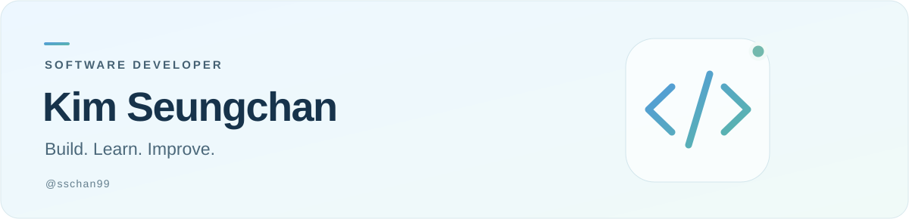

  

  서비스와 게임을 만들고, 배운 것을 코드로 남깁니다. 
  Backend · Interactive Projects · Problem Solving

 

## 안녕하세요, 김승찬입니다.

백엔드 서비스부터 인터랙티브 게임까지, 다양한 프로젝트를 통해 개발 경험을 쌓아왔습니다.
이곳에 함께 만든 프로젝트와 문제 해결의 기록을 모으고 있습니다.

## Selected Projects

| 프로젝트 | 소개 | 프로젝트 기술 |
| :--- | :--- | :--- |
| **[CheckMate Generator](https://github.com/sschan99/checkmate-generator)** | 여행 조건에 맞는 체크리스트를 생성하는 API. 입력·응답 검증과 오류 처리를 보완했습니다. | JavaScript · Express · Gemini API |
| **[FunBox](https://github.com/boostcampwm2023/and05-funbox)** | 지도에서 친구를 찾고 채팅과 미니게임으로 교류하는 소셜 플랫폼. 백엔드 개발에 참여했습니다. | TypeScript · NestJS · MySQL · Socket.IO |
| **[NearBuy](https://github.com/Dcom-KHU/nearbuy-backend)** | 1인 가구를 위한 공동구매·동네 거래 플랫폼의 백엔드 프로젝트입니다. | Java · Spring Boot · MySQL · MongoDB |
| **[Home Training Game](https://github.com/haram1117/HomeTrainingGame)** | 동작 인식과 근전도 센서를 활용해 운동을 게임으로 연결한 팀 프로젝트입니다. | Unity · C# · Python |

## Experience with

**Backend** &nbsp; TypeScript / JavaScript · NestJS / Express · Java / Spring Boot  
**Game** &nbsp; Unity · C#  
**Data** &nbsp; MySQL · MongoDB  
**Problem Solving** &nbsp; Python

## Learning Log

[**Algorithm**](https://github.com/sschan99/Algorithm) — 알고리즘 문제 풀이를 기록합니다.

---

  <a href="https://github.com/sschan99?tab=repositories">프로젝트 더 보기 ↗</a>

